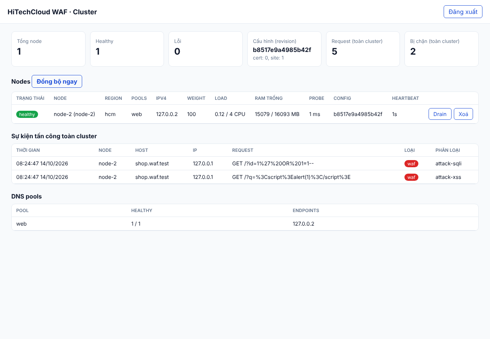

English: [en/cluster.md](en/cluster.md)

# HiTechCloud WAF Cluster — nhiều node + DNS

```
                    ┌──────────────── Control plane ────────────────┐
  Quản trị ───────► │ hcw controller :7443  (dashboard + API)        │
                    │   │  đọc cấu hình                              │
                    │   ▼                                            │
                    │ WAF engine "primary" (console :9443)           │
                    └───────────▲───────────────────▲────────────────┘
                     heartbeat  │  snapshot cấu hình │ endpoints (pool)
             ┌──────────────────┼──────────┐        │
             │                  │          │   ┌────┴─────────┐   ┌──────────────┐
     ┌───────┴──────┐   ┌───────┴──────┐   │   │ hcw dns #1   │   │ hcw dns #2   │
     │ Node HN-01   │   │ Node HCM-01  │ … │   │ (NS1)        │   │ (NS2)        │
     │ hcw agent    │   │ hcw agent    │   │   └──────▲───────┘   └──────▲───────┘
     │ WAF engine   │   │ WAF engine   │   │          │ truy vấn DNS     │
     └──────▲───────┘   └──────▲───────┘   │          └──── Người dùng ──┘
            └──── traffic HTTP/S ─────────────────────────────┘
```

## Thành phần (`cluster/`, binary `hcw`)

| Lệnh | Chạy ở đâu | Chức năng |
|---|---|---|
| `hcw controller` | Máy quản trị | Danh sách node, kiểm tra sức khỏe (heartbeat + probe HTTP), drain/weight, snapshot cấu hình từ engine primary, dashboard whitelabel |
| `hcw agent` | Mỗi node WAF | Gửi heartbeat (CPU, RAM, disk, health engine), áp dụng cấu hình (site, cert…) vào engine local qua API |
| `hcw dns` | ≥ 2 máy (NS1/NS2) | DNS authoritative: chỉ trả về IP các node khỏe trong pool; weighted, ưu tiên region theo EDNS Client Subnet hoặc theo quốc gia (GeoDNS), fail-open tùy chọn; bản ghi tĩnh (A, AAAA, CNAME, TXT, MX, NS, SRV, CAA), wildcard, ủy quyền subdomain |
| `hcw token` | – | Sinh token ngẫu nhiên |

### Sức khỏe node

Một node được coi là healthy khi đủ cả 3 điều kiện:

1. Heartbeat gần nhất cách đây không quá `heartbeat_timeout`.
2. Engine local trả lời health API.
3. `probe_url` (nếu có) trả về mã < 500. Controller tự gọi probe, và URL bắt
   buộc trỏ về đúng IP của node để tránh SSRF.

Node đang **drain** bị loại khỏi DNS nhưng vẫn ở trong cluster (dùng khi bảo
trì).

### Đồng bộ cấu hình

Controller đọc các resource khai báo trong `controller.primary.resources` từ
engine primary và tạo snapshot có `revision`. Khi agent thấy revision mới, nó
so khớp theo `key_fields`:

- tạo object còn thiếu, cập nhật object khác;
- xóa object thừa nếu `prune: true`;
- tự dịch ID tham chiếu chéo giữa các node (ví dụ `site.cert_id` → `cert`).

Token API của từng engine chỉ nằm trên node đó, không đi qua controller.

> Đường dẫn và tên trường API mặc định trong `examples/controller.yaml` phải
> được đối chiếu với tài liệu API của phiên bản engine đang chạy. Bật `prune`
> sau khi đã kiểm tra.

### Thống kê và sự kiện tập trung

Với engine HiTechCloud, mỗi heartbeat của agent gửi kèm:

- bộ đếm request/chặn của node;
- các sự kiện tấn công mới kể từ lần trước (tối đa 100 mỗi lần).

Controller cộng dồn thành số liệu toàn cluster và giữ 5000 sự kiện gần nhất
trong bộ nhớ. Xem qua dashboard hoặc `GET /v1/events?limit=&node=` (admin).

### Đăng ký node (enrollment) và secret riêng của từng node

Mỗi node xác thực bằng **secret riêng** gắn với node ID của nó, thay cho token
dùng chung:

1. Admin tạo **enrollment token** dùng một lần trên dashboard (mục *Đăng ký
   node*) hoặc `POST /v1/enroll-tokens`, có thể gắn sẵn `node_id`, `pools`,
   `region` và thời hạn (`expires_in`, mặc định 24 giờ, tối đa 30 ngày).
   Token (`hcwe_...`) chỉ hiển thị **một lần**.
2. Trên node, ghi token vào file và cài agent:
   `install.sh agent --controller https://ctl:7443 --enroll-token-file enroll.token --ca ca.crt`
   (agent.yaml: `enroll_token_file: /etc/hcw/secrets/enroll.token`).
3. Lần chạy đầu, agent gọi `POST /v1/enroll` một lần, nhận **node secret**
   (`hcwn_...`, 256 bit ngẫu nhiên) và lưu vào
   `<data_dir>/node-credential.json` (quyền 0600). Từ đó agent dùng secret này
   cho heartbeat và snapshot; khởi động lại thì dùng lại secret đã lưu, không
   đăng ký lại. Token đã dùng thì không dùng lại được.

Controller chỉ lưu **hash SHA-256** của token và secret, trong
`credentials_file` (mặc định `node-credentials.json` cạnh `state_file`, quyền
0600); so sánh theo thời gian hằng (constant-time). Ràng buộc:

- Secret của node A chỉ báo cáo được cho node A: heartbeat mang `id` khác bị
  từ chối **403**; sự kiện tấn công luôn gắn với node của secret.
- Nếu token có `pools` / `region` thì controller áp đặt các giá trị đó, bỏ qua
  giá trị agent tự khai báo.
- Token không gắn `node_id`: node ID là `id` trong agent.yaml, không có thì là
  hostname (chữ thường); không được lấy ID của node đang có secret còn hiệu
  lực (409). Token gắn `node_id` khác với `id` của agent → 403.
- Khi một node ID đã đăng ký, token chung **không bao giờ** được chấp nhận cho
  node đó nữa (kể cả sau khi thu hồi) — chỉ có thể đăng ký lại bằng token mới.

**Thu hồi**: xoá node (dashboard, hoặc `DELETE /v1/nodes/{id}`) đồng thời thu
hồi secret; agent nhận 401 và ghi log yêu cầu token mới. Enrollment token chưa
dùng thu hồi bằng `DELETE /v1/enroll-tokens/{id}`.

**Đổi secret (rotate)**: nút *Đổi secret* trên dashboard hoặc
`POST /v1/nodes/{id}/rotate` tạo token mới gắn với node (giữ pools/region).
Ghi token mới đè lên `enroll_token_file` trên node: agent đọc lại file mỗi chu
kỳ, thấy token khác thì đăng ký lại, secret cũ hết hiệu lực ngay khi đăng ký
xong (không cần khởi động lại). Thêm `{"revoke_current": true}` để vô hiệu
secret cũ ngay lập tức.

#### Chuyển đổi từ token chung (`node_token`)

`node_token` vẫn hoạt động (tương thích ngược) nhưng đã **lỗi thời**: controller
ghi cảnh báo khi khởi động và mỗi giờ một lần cho từng node còn dùng nó. Cột
*Xác thực* của dashboard (`auth` trong `GET /v1/nodes`) cho biết node nào dùng
`node_secret` hay `shared_token`. Các bước:

1. Nâng cấp controller và agent (không cần đổi cấu hình, cluster chạy như cũ).
2. Với từng node: tạo enrollment token gắn `node_id` của node, ghi vào
   `/etc/hcw/secrets/enroll.token`, thêm `enroll_token_file:` vào agent.yaml
   (có thể giữ `node_token_file` — agent chỉ quay về token chung khi chưa đăng
   ký được), khởi động lại agent. Hoặc chạy lại
   `install.sh agent ... --enroll-token-file enroll.token`.
3. Khi mọi node đều hiện *secret riêng*, đặt `require_enrollment: true` trong
   controller.yaml và khởi động lại controller: token chung bị từ chối (401),
   có thể xoá `node_token_file` khỏi controller và các node.



## DNS

### Chọn node theo region

Với một bản ghi pool (`pool: web`), DNS chỉ trả về các node khỏe của pool,
chọn ngẫu nhiên có trọng số (`weight`), tối đa `max_answers` địa chỉ. Địa chỉ
của client là **EDNS Client Subnet** (ECS) nếu resolver gửi kèm, ngược lại là
địa chỉ của resolver. Region được xác định lần lượt:

1. `prefer_region` của bản ghi: CIDR đầu tiên chứa địa chỉ client;
2. `prefer_country`: quốc gia của client (tra GeoIP) có trong `countries`;
3. `prefer_country`: châu lục của client có trong `continents`.

Bước nào ra region có node khỏe thì chỉ trả về các node của region đó; region
không có node khỏe thì thử bước tiếp theo; không khớp gì (hoặc không có
GeoIP) thì trả về mọi node khỏe như trước. Khi câu trả lời phụ thuộc địa chỉ
client, DNS trả lại ECS với scope bằng độ dài subnet; với câu trả lời không
phụ thuộc client (bản ghi tĩnh), scope là 0 để resolver dùng chung cache.

### GeoDNS theo quốc gia

Cần một database quốc gia dạng `.mmdb` (MaxMind GeoLite2-Country hoặc DB-IP
Country Lite, miễn phí):

```yaml
dns:
  geoip_db: /etc/hcw/geoip/country.mmdb   # thay file là tự nạp lại (theo refresh)
  pools:                                   # mặc định cho mọi bản ghi của pool
    web:
      prefer_country:
        - {countries: [VN], region: hn}
        - {countries: [TH, LA, KH, MY, SG], region: hcm}
        - {continents: [AS, OC], region: hcm}   # AF AN AS EU NA OC SA
  zones:
    - name: waf.hitechcloud.vn
      records:
        - {name: edge, pool: web}
        - name: vip
          pool: web
          prefer_country:                  # thay thế quy tắc của pool
            - {countries: [VN, TH], region: asia}
```

- Mã quốc gia theo ISO 3166-1 alpha-2; khớp quốc gia được ưu tiên hơn khớp
  châu lục, giữa các quy tắc cùng loại thì quy tắc đầu tiên thắng.
- `prefer_region` (CIDR) luôn được thử trước `prefer_country`.
- Database được đọc vào RAM; khi file đổi (mtime/kích thước), DNS nạp lại ở
  chu kỳ `refresh` tiếp theo, lỗi thì giữ database cũ. Cập nhật định kỳ bằng
  cron (ví dụ hàng tháng), ghi ra file tạm rồi `mv` đè lên file cũ.
- Thiếu `geoip_db` thì các quy tắc `prefer_country` bị bỏ qua (có cảnh báo
  khi khởi động); `geoip_db` đã khai báo mà không mở được thì DNS không khởi
  động.

### Bản ghi tĩnh

Ngoài bản ghi pool, zone chứa bản ghi tĩnh `A`, `AAAA`, `CNAME`, `TXT`, `MX`,
`NS`, `SRV`, `CAA` từ hai nguồn:

1. **File cấu hình** `dns.yaml` của từng DNS server (`records` của zone).
2. **Controller**: quản lý trên dashboard (mục *Bản ghi DNS tĩnh*) hoặc qua
   API `/v1/dns/records`. Controller lưu vào `dns_records_file` (mặc định
   `dns-records.json` cạnh `state_file`; ghi file tạm rồi đổi tên giống state
   của node). DNS server tải danh sách cùng chu kỳ `refresh` với pool (có
   `ETag`, không đổi thì controller trả 304); controller không truy cập được
   thì DNS giữ danh sách cũ. Mỗi DNS server chỉ phục vụ bản ghi có `zone` trùng
   tên một zone trong `dns.yaml` của nó.

Cú pháp `value` giống zone file; tên không có dấu chấm cuối được hiểu là nằm
trong zone (`mail` → `mail.<zone>.`):

| Loại | Ví dụ `value` |
|---|---|
| A / AAAA | `203.0.113.10` / `2001:db8::10` |
| CNAME | `edge.waf.hitechcloud.vn.` |
| TXT | `v=spf1 include:_spf.example.vn -all` (không có ngoặc kép thì giữ nguyên văn và tự chia đoạn 255 byte; có ngoặc kép thì theo cú pháp zone file) |
| MX | `10 mail.example.vn.` |
| NS | `ns1.example.net.` |
| SRV | `10 60 5060 sip.example.vn.` |
| CAA | `0 issue "letsencrypt.org"` |

Quy tắc trả lời:

- **Apex**: SOA và NS được tạo từ `ns`, `hostmaster`, `ttl` của zone; bản ghi
  NS tĩnh tại `@` được thêm vào danh sách NS. Serial SOA là giá trị lớn hơn
  giữa `serial` của zone và serial của controller (tăng sau mỗi thay đổi).
- **NXDOMAIN / NODATA**: tên không tồn tại → NXDOMAIN; tên tồn tại (kể cả tên
  trung gian như `deep` khi có `a.b.deep`) nhưng không có loại được hỏi →
  NOERROR rỗng. Cả hai kèm SOA trong phần authority.
- **CNAME**: không đặt tại `@` và không đi cùng dữ liệu khác trên cùng tên.
  Đích nằm trong zone mà DNS phục vụ thì được trả kèm luôn (tối đa 8 bước,
  chống vòng lặp); đích bên ngoài để resolver tự tra.
- **Wildcard** `*.app`: trả lời cho mọi tên dưới `app` chưa tồn tại (RFC 4592);
  tên trong câu trả lời là tên được hỏi. Bản ghi pool cũng dùng được wildcard
  (`{name: "*.cdn", pool: web}`).
- **NS dưới apex** (ví dụ `lab`): ủy quyền subdomain — trả referral (không
  authoritative) kèm glue A/AAAA nếu name server nằm trong zone.
- Trùng tên giữa file cấu hình và controller (CNAME đụng dữ liệu khác, bản ghi
  lặp): **file cấu hình thắng**, bản ghi của controller bị bỏ qua và ghi log.

Ví dụ API:

```bash
API=https://controller.example.vn:7443/v1/dns/records
curl -H "Authorization: Bearer $ADMIN" "$API?zone=waf.hitechcloud.vn"
curl -H "Authorization: Bearer $ADMIN" -d '{"zone":"waf.hitechcloud.vn","name":"@","type":"MX","value":"10 mail.hitechcloud.vn.","ttl":300}' "$API"
curl -X PUT -H "Authorization: Bearer $ADMIN" -d '{"zone":"waf.hitechcloud.vn","name":"www","type":"A","value":"203.0.113.11"}' "$API/<id>"
curl -X DELETE -H "Authorization: Bearer $ADMIN" "$API/<id>"
```

Trường của bản ghi: `zone`, `name` (`@`, `www`, `*.app`), `type`, `value`,
`ttl` (0 = TTL của zone, tối đa 604800), `comment`. Controller kiểm tra cú
pháp và xung đột trước khi lưu (lỗi cú pháp → 400, xung đột/trùng → 409).

## Triển khai nhanh

```bash
# 1) Control plane
sudo cluster/deploy/bootstrap-controller.sh controller.example.vn 203.0.113.5
sudo cp cluster/examples/controller-hcw-engine.yaml /etc/hcw/controller.yaml   # sửa cho phù hợp
# Tạo API token trên console primary → /etc/hcw/secrets/primary-engine.token
docker compose -f cluster/deploy/compose.controller.yaml up -d --build

# 2) Mỗi node WAF (đã chạy engine hcw-waf, ví dụ `docker compose up -d hcw-waf`
#    trong waf/deploy/)
#    copy ca.crt từ controller sang /etc/hcw/tls/, tạo enrollment token trên
#    dashboard và ghi vào /etc/hcw/secrets/enroll.token
sudo cp cluster/examples/agent.yaml /etc/hcw/agent.yaml             # sửa id/ip/region/pools
docker compose -f cluster/deploy/compose.node.yaml up -d --build

# 3) DNS (≥ 2 máy) – copy ca.crt + dns.token
sudo cp cluster/examples/dns.yaml /etc/hcw/dns.yaml
docker compose -f cluster/deploy/compose.dns.yaml up -d --build
```

`controller-hcw-engine.yaml` là mẫu cho engine `hcw-waf`; `controller.yaml`
là mẫu tổng quát có chú thích đầy đủ mọi tuỳ chọn. Trên node, có thể chạy cả
engine lẫn agent bằng `waf/deploy/compose.yaml` thay cho `compose.node.yaml`
(chỉ có agent).

Ở nhà đăng ký tên miền, khai báo `ns1`/`ns2` (glue record) cho zone, ví dụ
`waf.hitechcloud.vn`. Khách hàng trỏ CNAME tên miền của mình về
`edge.waf.hitechcloud.vn` (hoặc một record riêng cho từng khách).

Dashboard: `https://controller.example.vn:7443/`, đăng nhập bằng `admin.token`.

## API controller

Đặc tả đầy đủ: [`docs/api/cluster.openapi.yaml`](api/cluster.openapi.yaml)
(xem [docs/api/README.md](api/README.md)).

| Method & path | Token | Mô tả |
|---|---|---|
| `GET /healthz` | – | liveness |
| `POST /v1/heartbeat` | node secret (hoặc node token chung, lỗi thời) | agent báo cáo |
| `GET /v1/config/snapshot` | node secret (hoặc node token chung, lỗi thời) | snapshot cấu hình |
| `POST /v1/enroll` | enrollment token | agent đổi token dùng một lần lấy node secret |
| `GET/POST /v1/enroll-tokens`, `DELETE /v1/enroll-tokens/{id}` | admin | tạo / liệt kê / thu hồi enrollment token |
| `GET /v1/nodes`, `GET/PATCH/DELETE /v1/nodes/{id}` | admin | quản lý node (`{"drain":true}`, `{"weight_override":50}`); `DELETE` thu hồi luôn secret |
| `POST /v1/nodes/{id}/rotate` | admin | tạo token mới để đổi secret của node (`{"revoke_current":true}` để thu hồi ngay) |
| `GET /v1/pools` | admin | các pool + endpoint |
| `GET /v1/events` | admin | sự kiện tấn công toàn cluster |
| `GET /v1/pools/{pool}/endpoints` | dns/admin | dùng cho DNS |
| `GET /v1/dns/records?zone=` | dns/admin | bản ghi DNS tĩnh + `serial` (hỗ trợ `If-None-Match`) |
| `POST /v1/dns/records`, `GET/PUT/DELETE /v1/dns/records/{id}` | admin | quản lý bản ghi DNS tĩnh |
| `GET/POST /v1/sync` | admin | trạng thái / đồng bộ ngay |

## Kiểm thử

```bash
cd cluster && go vet ./... && go test -race ./...
```

Kiểm tra DNS thủ công trên cổng cao (không cần root), với `listen: ":5353"`:

```bash
dig @127.0.0.1 -p 5353 waf.hitechcloud.vn SOA
dig @127.0.0.1 -p 5353 edge.waf.hitechcloud.vn A +subnet=14.160.1.0/24
dig @127.0.0.1 -p 5353 x.cdn.waf.hitechcloud.vn A
```

## Ghi chú bảo mật

- Node không được khai báo địa chỉ loopback, link-local, multicast; probe
  của controller cũng từ chối kết nối tới các dải đó (bật
  `allow_loopback_nodes: true` chỉ khi thử nghiệm trong lab).
- Enrollment token và node secret chỉ được lưu dưới dạng hash; token được
  gửi qua TLS tới controller (agent bắt buộc `https://` trừ loopback), nên
  luôn ghim CA (`controller_ca`).
- Mỗi node có secret riêng (xem *Đăng ký node*): một node bị chiếm không thể
  gửi heartbeat/sự kiện thay node khác (403). Bật `require_enrollment: true`
  sau khi chuyển đổi xong để loại bỏ hẳn token dùng chung.
- Một node đã đăng ký không thể đổi IPv4/IPv6 qua heartbeat (chống chiếm
  node bằng token dùng chung). Khi node đổi IP thật, xoá node trên dashboard
  hoặc `DELETE /v1/nodes/{id}` rồi để agent đăng ký lại (node dùng secret
  riêng cần enrollment token mới); hoặc đặt `allow_address_change: true`.
- Agent chỉ đồng bộ các collection cấu hình dưới `/api/open/` (không bao giờ
  users, backup/restore, audit, alerts, `me/`).
- DNS server bắt buộc `https://` tới controller (trừ loopback).
- `install.sh` kiểm tra SHA256 của binary với `SHA256SUMS` của release; dùng
  `--enroll-token-file` / `--node-token-file` / `--dns-token-file` để token
  không lộ trên dòng lệnh.
