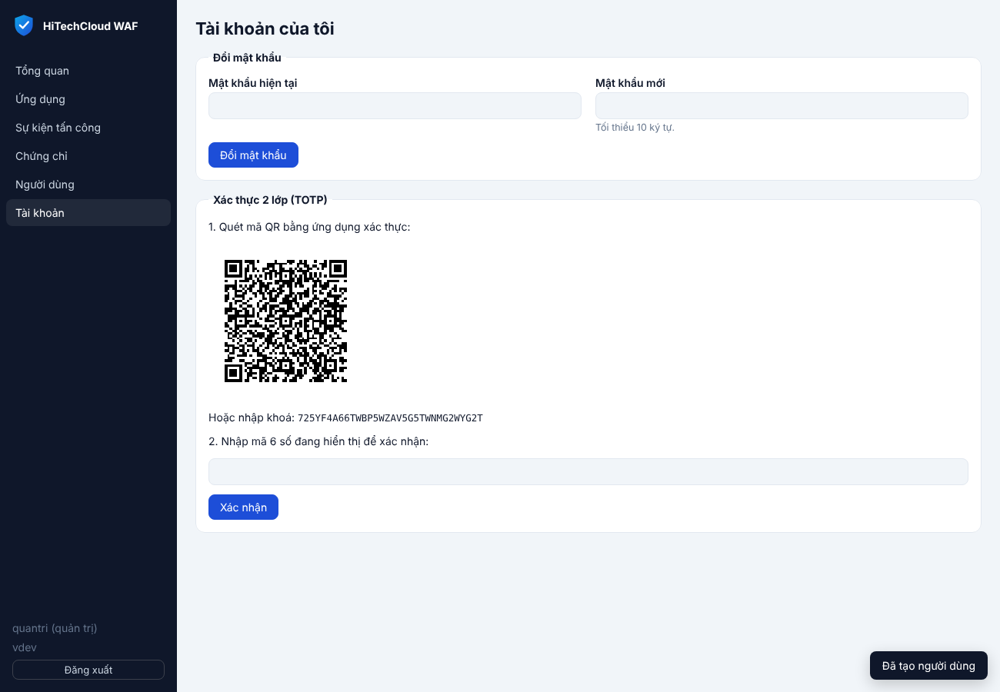
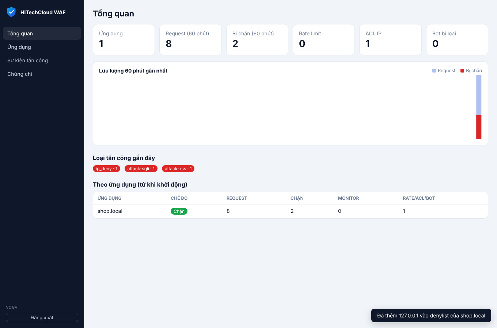
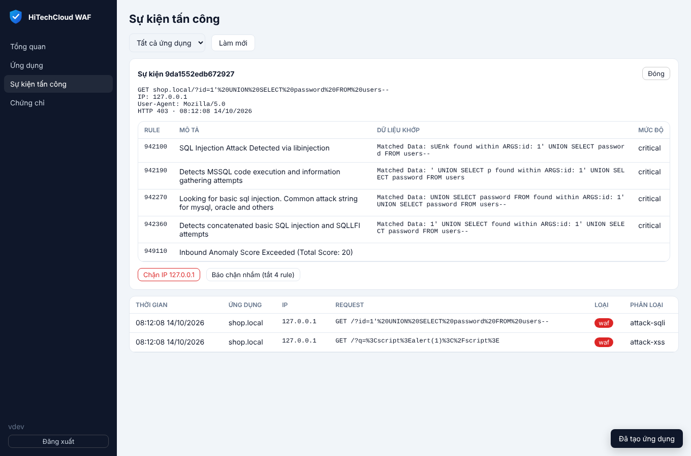
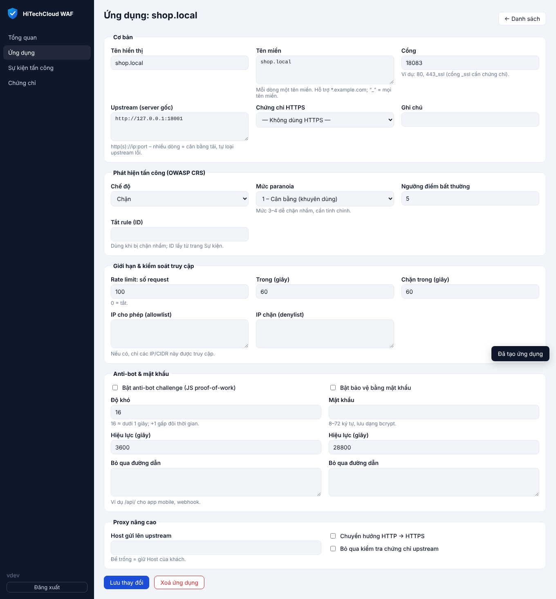

English: [en/engine.md](en/engine.md)

# HiTechCloud WAF Engine (`waf/`)

Engine WAF riêng của HiTechCloud, mã nguồn mở hoàn toàn, **không phụ thuộc
image của Chaitin**. Binary: `hcw-waf`.

## Luồng xử lý một request

```
Client ─► listener (HTTP / HTTPS theo SNI)
          │
          ├─ chọn site theo Host (tên chính xác, wildcard *.domain, hoặc "_")
          ├─ đường dẫn không chuẩn (`/./`, `/../`, `//`, `\`) → 400
          ├─ redirect HTTPS (tuỳ chọn, chỉ tới tên miền của site)
          ├─ ACL IP: ip_deny → 403, ip_allow (nếu có) → 403
          ├─ Rule theo đường dẫn (allow / deny / skip_waf / rate_limit)
          ├─ Threat intelligence: IP thuộc danh sách đe dọa → 403 / challenge / log
          ├─ Rate limit theo IP/site (IPv6 gộp theo /64) → 429 + thời gian chặn
          ├─ Auth challenge (mật khẩu) → trang đăng nhập
          ├─ Anti-bot challenge (JS proof-of-work) → trang kiểm tra trình duyệt
          │   (bot tìm kiếm đã xác minh bằng DNS được bỏ qua nếu bật allow_verified)
          ├─ OWASP Coraza + Core Rule Set v4 (SQLi, XSS, RCE, LFI/RFI,
          │   path traversal, scanner, protocol attack…) → 403
          │   (giới hạn số tham số/kích thước body và số lượt kiểm tra đồng
          │   thời, xem "Giới hạn kiểm tra"; file tĩnh có thể chỉ chạy phase 1)
          ├─ Cache response tĩnh trong RAM (tuỳ chọn) → trả ngay, không gọi upstream
          ├─ Reverse proxy → upstream (round-robin / weighted / least_conn /
          │   ip_hash / random, sticky session; upstream lỗi bị loại 10s)
          ├─ Sửa header request/response theo cấu hình site
          ├─ Bảo vệ động: mã hoá HTML/JS trong response (tuỳ chọn)
          └─ Nén gzip response cho client (tuỳ chọn)
```

Trang chặn mang thương hiệu HiTechCloud và hiển thị **Event ID** để tra cứu.
Mỗi lần chặn sinh một sự kiện, lưu trong bộ nhớ và ghi vào file JSONL.

## Chế độ bảo vệ của từng site

| Trường | Ý nghĩa |
|---|---|
| `mode` | `block` (chặn), `monitor` (chỉ ghi log), `off` (proxy thuần) |
| `paranoia` | 1–4. Mặc định 1, ít chặn nhầm. PL3–4 bắt được nhiều hơn nhưng cần tinh chỉnh |
| `anomaly_threshold` | Ngưỡng điểm CRS để chặn (mặc định 5) |
| `disabled_rules` | Danh sách ID rule CRS tắt cho site, dùng khi bị chặn nhầm |
| `max_args` | Số tham số tối đa (query, form, trường JSON) được kiểm tra; vượt quá → 400. `0` (mặc định) = 255, tối đa 10000 |
| `static_fast_path` | `true`: request file tĩnh chỉ chạy CRS phase 1 (mặc định `false`, xem "Giới hạn kiểm tra") |
| `rate_limit` | `{requests, window_sec, block_sec}` |
| `ip_allow` / `ip_deny` | Danh sách IP hoặc CIDR |
| `ports` | `"80"`, `"443_ssl"` (cổng `_ssl` bắt buộc có `cert_id`) |
| `upstreams` | `http(s)://host:port`, có thể nhiều upstream; thêm ` weight=N` (1–100) để đặt trọng số |
| `lb` | Thuật toán cân bằng tải: `round_robin` (mặc định), `weighted`, `least_conn`, `ip_hash`, `random` |
| `sticky`, `sticky_cookie`, `sticky_ttl_sec` | Giữ khách ở một upstream bằng cookie (mặc định `hcw_srv`, hết hạn khi đóng trình duyệt) |
| `request_headers`, `response_headers` | Rule `set` / `add` / `remove` header gửi lên upstream và trả về cho khách |
| `hide_server_headers` | Xoá `Server`, `X-Powered-By`, `X-AspNet-Version`, `X-AspNetMvc-Version` khỏi response của upstream |
| `upstream_host`, `upstream_insecure`, `redirect_https` | Tuỳ chọn proxy |
| `auto_tls` | Tự cấp và gia hạn chứng chỉ Let's Encrypt (cần `acme.enabled`) |
| `hsts` | Thêm `Strict-Transport-Security` vào các response HTTPS |
| `country_allow` / `country_deny` | Mã quốc gia ISO, ví dụ `VN`. Cần `geoip_db` trên node |
| `threat_intel` | `off` (mặc định), `block`, `challenge`, `monitor`: xử lý IP nằm trong danh sách đe dọa (xem bên dưới) |
| `dynamic_protection` | Mã hoá HTML/JS mỗi response, chống thu thập dữ liệu (xem bên dưới) |
| `rules` | Rule theo đường dẫn (xem bên dưới) |
| `health_check` | `{path, interval_sec, timeout_sec, unhealthy, healthy}`: kiểm tra upstream chủ động |
| `custom_rules` | Rule SecLang riêng của site (ID 1–99999, không được `Include` hay đọc file) |

### Rule theo đường dẫn (`rules`)

```json
"rules": [
  {"path": "/login", "exact": true, "methods": ["POST"], "action": "rate_limit",
   "rate_limit": {"requests": 5, "window_sec": 60, "block_sec": 300}},
  {"path": "/webhook", "action": "allow", "ips": ["203.0.113.0/24"]},
  {"path": "/api/upload", "action": "skip_waf"},
  {"path": "/wp-admin", "action": "deny"}
]
```

| Hành động | Tác dụng |
|---|---|
| `allow` | Whitelist: bỏ qua rate limit, anti-bot, mật khẩu và WAF (ACL IP/quốc gia vẫn áp dụng) |
| `deny` | Trả về 403 |
| `skip_waf` | Chỉ bỏ qua bộ lọc OWASP CRS |
| `rate_limit` | Giới hạn tốc độ riêng cho đường dẫn (cộng thêm vào giới hạn chung của site) |

- Rule xét theo thứ tự; `allow` và `deny` dừng việc xét các rule sau.
- `path` khớp theo tiền tố, hoặc khớp chính xác nếu đặt `exact`.
- `methods` và `ips` là điều kiện tùy chọn.
- Trong console, quản lý ở phần **Rule theo đường dẫn** của form ứng dụng.

### Anti-bot challenge (`bot_challenge`)

`{"enabled": true, "difficulty": 16, "ttl_sec": 3600, "exclude_paths": ["/api/"]}`

Trình duyệt phải giải một bài toán SHA-256 proof-of-work bằng JavaScript.
Đo trên Chromium với độ khó 16: 140–575 ms. Giải xong, trình duyệt nhận
cookie `hcw_bot` (HttpOnly, ký HMAC, gắn với site và IP; với IPv6 là gắn với
dải /64). Script, curl và bot không có JS engine sẽ bị chặn lại. Nonce chỉ
dùng được trong 5 phút, đúng site, đúng IP.

Dùng `exclude_paths` cho API, webhook và app mobile, vì các client này không
chạy được JS.

#### Bot tìm kiếm đã xác minh (`allow_verified`)

`{"enabled": true, "allow_verified": true}`

Crawler của công cụ tìm kiếm không chạy được JS nên sẽ kẹt ở trang challenge,
ảnh hưởng SEO. Khi bật `allow_verified`, request có User-Agent của Googlebot,
Bingbot, Applebot, YandexBot, Baiduspider, Yahoo Slurp hoặc coccocbot được
kiểm tra bằng **reverse DNS + forward-confirm**:

1. Tra PTR của IP, ví dụ `crawl-66-249-66-1.googlebot.com`.
2. Tên miền phải thuộc miền chính thức của bot (`googlebot.com`, `google.com`,
   `search.msn.com`, `applebot.apple.com`, `yandex.ru/.net/.com`,
   `baidu.com/.jp`, `crawl.yahoo.net`, `coccoc.com`).
3. Phân giải xuôi tên đó phải ra đúng IP ban đầu. Bước này chặn được kẻ tự đặt
   PTR giả cho IP của mình.

Bot đạt cả ba bước được bỏ qua anti-bot challenge (kể cả challenge do
threat intelligence), **nhưng vẫn qua bộ lọc WAF**, rate limit và ACL. Bot giả
mạo User-Agent bị xử lý như khách bình thường. Kết quả được cache 6 giờ (lỗi
DNS tạm thời chỉ cache 1 phút), cache giới hạn 20.000 mục, mỗi lần tra có
timeout 2 giây và tối đa 64 lượt tra đồng thời; vượt quá thì request được coi
là chưa xác minh. `googleusercontent.com` không được chấp nhận vì mọi máy ảo
trên Google Cloud đều có PTR dạng này.

### Auth challenge (`auth`)

`{"enabled": true, "password": "…", "ttl_sec": 28800, "exclude_paths": []}`

- Mật khẩu được băm bcrypt ngay khi lưu; API chỉ trả về `password_hash`.
- Đổi mật khẩu thì mọi phiên đăng nhập cũ hết hiệu lực.
- Sai 10 lần trong 10 phút thì bị khoá 15 phút.
- Đăng xuất: `/.hcw/logout`.

Đường dẫn `/.hcw/` được engine dành riêng trên mọi site.

**Cluster:** đặt cùng một `challenge_secret_file` trên tất cả node. Khi DNS
chuyển khách sang node khác, khách không phải giải lại challenge.

Body nhị phân (octet-stream, ảnh, video, zip, pdf, gRPC) chỉ được kiểm tra
phần header, không quét nội dung. Với body multipart, engine kiểm tra
`body_limit_kb` đầu tiên, phần còn lại vẫn chuyển đủ lên upstream. Body JSON,
form, XML lớn hơn `body_args_limit_kb` bị từ chối (xem bên dưới).

### Giới hạn kiểm tra

OWASP CRS tốn CPU theo **số tham số** và **số byte** được kiểm tra: ở PL1
khoảng 0,25 ms cho mỗi tham số query, 0,4 ms cho mỗi trường JSON và 6–8 µs
cho mỗi byte giá trị (body JSON 1 MB ≈ 8 giây CPU). Không giới hạn thì vài
request mỗi giây đủ chiếm hết CPU của node. Engine đặt các giới hạn sau:

| Giới hạn | Mặc định | Vượt quá |
|---|---|---|
| Số tham số mỗi nhóm (query, body) – `max_args` của site | 255 | 400, rule 100002 (query) / 100003 (body), trước khi rule CRS nào của phase đó chạy |
| Tổng tham số query + body (CRS `tx.max_num_args`, cùng giá trị `max_args`) | 255 | rule CRS 920380 cộng điểm critical (chặn ở ngưỡng mặc định 5) |
| Độ sâu lồng nhau của JSON | 64 | 400, rule 200002 (lỗi phân tích body) |
| Body được phân tích thành tham số (JSON, form, XML, text – trừ multipart và nhị phân) – `body_args_limit_kb` của node | 128 KB (như `SecRequestBodyNoFilesLimit` của ModSecurity), không quá `body_limit_kb` | site `block`: 413, sự kiện loại `body_limit`. Site `monitor`: chỉ kiểm tra 128 KB đầu, ghi sự kiện `body_limit`/`monitor`, request vẫn đi qua |
| Số lượt kiểm tra CRS chạy cùng lúc trên node – `waf_concurrency` | 2 × số lõi (`GOMAXPROCS`) | request chờ; khách ngắt kết nối hoặc chờ quá 10 giây → 503 (`Retry-After: 5`) |

Site `monitor` không bị chặn vì vượt `max_args`, nhưng chỉ `max_args` tham số
đầu được kiểm tra và sự kiện `monitor` vẫn được ghi (rule 100002/100003).
API cần body lớn hơn có thể tăng `body_args_limit_kb` trên node, hoặc dùng rule
`skip_waf` cho đường dẫn đó; site cần nhiều trường hơn (ví dụ form quản trị
lớn) tăng `max_args`.

Thêm vào đó:

- Body được đọc **trước** khi chiếm lượt kiểm tra, nên khách upload chậm không
  giữ lượt của người khác. Body ≤ 128 KB nằm trong RAM, lớn hơn được ghi ra
  file tạm và xoá khi request xong.
- Transaction Coraza (vài MB mỗi request) được đóng **ngay khi có kết quả**,
  trước khi proxy lên upstream. Response dài (SSE, long polling, tải file)
  không còn giữ bộ nhớ của WAF.

#### Đường tắt cho file tĩnh (`static_fast_path`)

Mặc định tắt. Khi bật, request thỏa **tất cả** điều kiện sau chỉ chạy phase 1
của CRS (kiểm tra giao thức, method, scanner, header), không chạy phase 2:

- method `GET` hoặc `HEAD`, không có query string (kể cả `?` rỗng), không có body;
- đường dẫn kết thúc bằng `.css .js .mjs .map .png .jpg .jpeg .gif .svg .webp
  .avif .ico .bmp .woff .woff2 .ttf .otf .eot`;
- đường dẫn không có `;` và không có đoạn nào mang đuôi script (`.php`, `.asp`,
  `.aspx`, `.jsp`, `.cgi`, `.pl`, `.py`…), vì `/index.php/app.css` chạy
  `index.php` trên nhiều máy chủ.

Điểm bất thường của phase 1 vẫn được đánh giá (CRS early blocking, rule
949111), nên scanner như sqlmap, nikto vẫn bị chặn ở file tĩnh. ACL IP, quốc
gia, rule đường dẫn, threat intelligence, rate limit, auth và anti-bot
challenge **luôn** chạy như bình thường.

Đánh đổi: phase 2 là nơi CRS kiểm tra cookie và tham số, nên cookie chứa
payload tấn công gửi kèm request file tĩnh sẽ không bị phát hiện. Chỉ bật khi
file tĩnh thực sự do web server tĩnh/CDN phục vụ, không đi qua mã ứng dụng
(ví dụ framework định tuyến mọi đường dẫn vào một controller). Đo trên máy
4 vCPU: request `.css` với header trình duyệt giảm từ ~2,4–2,6 ms xuống ~0,65 ms
CPU (xem `bench/RESULTS.md`).

Gợi ý: bật `monitor` vài ngày để xem log, thêm `disabled_rules` cho các rule
chặn nhầm, rồi mới chuyển sang `block`.

### Bảo vệ HTML/JS động (`dynamic_protection`)

`{"html": true, "js": true, "paths": ["/san-pham/"]}`

**HTML:** mỗi trang trả về được thay bằng một trang nạp nhỏ chứa nội dung gốc
đã mã hoá bằng khoá ngẫu nhiên riêng cho từng response. Tên biến cũng thay đổi
mỗi lần. Trình duyệt giải mã rồi dựng lại toàn bộ tài liệu, gồm `<head>`, CSS,
script ngoài và script inline. Tool thu thập dữ liệu (curl, Scrapy,
BeautifulSoup…) chỉ nhận được một khối dữ liệu vô nghĩa, và mỗi lần tải lại
khác nhau.

**JavaScript:** file JS được bọc mã hoá. Khi chạy, mã gốc được đưa vào một thẻ
`<script>` mới, nên vẫn chạy đúng như cũ: biến toàn cục, `let`/`const`/`class`
ở cấp cao nhất và `"use strict"` đều giữ nguyên.

**Không áp dụng (giữ nguyên response)** khi gặp:

- response có CSP riêng (vì CSP sẽ chặn trang nạp);
- ES module (`import`/`export`);
- charset khác UTF-8, nén bằng brotli, body lớn hơn 4 MB;
- request khác GET, hoặc status khác 200.

Nội dung gzip từ upstream được tự giải nén. Response đã mã hoá gắn
`Cache-Control: no-store` và header `X-HCW-Protected`.

**Lưu ý:**

- Đây là **làm rối** (obfuscation), không phải mã hoá bảo mật: khoá đi kèm
  trang. Mục đích là tăng chi phí cho kẻ thu thập dữ liệu và phân tích mã,
  tương tự tính năng của SafeLine.
- Công cụ tìm kiếm có chạy JS (Googlebot) vẫn đọc được, nhưng nên giới hạn bằng
  `paths` cho khu vực cần bảo vệ (giá, nội dung độc quyền) để không ảnh hưởng
  SEO.
- Đã kiểm thử trên Chromium thật: tiêu đề, CSS, script ngoài/inline và tiếng
  Việt đều đúng, không có lỗi console.

### Cache response (`cache`)

`{"enabled": true, "ttl_sec": 300, "max_object_kb": 1024, "paths": [], "extensions": [".css", ".js", ".png"]}`

Engine giữ bản sao response tĩnh trong RAM để request lặp lại không phải đi
tới upstream. Cache được kiểm tra **sau** ACL, rate limit, challenge và WAF,
nên mọi request (kể cả request trúng cache) vẫn bị kiểm tra đầy đủ.

- `paths` khác rỗng: cache mọi thứ dưới các tiền tố đường dẫn này (bỏ qua
  `extensions`). Rỗng: cache theo phần mở rộng trong `extensions` (mặc định
  `.css .js .png .jpg .jpeg .gif .svg .webp .ico .woff .woff2 .ttf .map`).
- `ttl_sec` mặc định 300, tối đa 86400; nếu upstream gửi `Cache-Control:
  s-maxage`/`max-age` ngắn hơn thì dùng giá trị đó.
- Chỉ lưu response `200` cho `GET` (HEAD dùng chung bản của GET), không có
  `Set-Cookie`, không có `Cache-Control: private/no-store/no-cache`, không
  `Vary` (trừ `Accept-Encoding`), body ≤ `max_object_kb`, và không phải
  response đã qua bảo vệ động (`X-HCW-Protected`). Request có
  `Authorization` hoặc `Range` luôn đi thẳng tới upstream.
- Response có header `X-HCW-Cache: MISS` (vừa được lưu) hoặc `HIT` (trả từ
  cache, kèm `Age`). `If-None-Match` khớp ETag được trả `304`.
- Toàn bộ site dùng chung một vùng nhớ LRU, kích thước đặt bằng `cache_mb`
  trong `waf.yaml` (mặc định 256, `-1` để tắt). Khi đầy, object ít dùng nhất bị
  loại trước.
- Khi cấu hình một site thay đổi, cache của site đó bị xoá để không trả nội
  dung sinh ra theo cấu hình cũ. Header `Cache-Control: no-cache` từ client
  **không** bỏ qua cache.

### Nén gzip (`compress`)

`"compress": true` nén response gửi cho client khi client chấp nhận gzip,
upstream chưa nén, kiểu nội dung là `text/*` (trừ `text/event-stream`),
`application/javascript`, `application/json`, `application/xml` hoặc
`image/svg+xml`, và body khai báo ≥ 1 KB (body không rõ độ dài vẫn được nén).
Response gắn `Vary: Accept-Encoding`, ETag chuyển thành ETag yếu (`W/"…"`).

Nén chạy song song với việc truyền dữ liệu nên không làm chậm streaming;
SSE, WebSocket và request `HEAD` được giữ nguyên. Object trong cache được lưu
dạng chưa nén, kèm một bản gzip tạo sẵn một lần khi lưu, nên request trúng
cache không phải nén lại. Lưu ý: với đường dẫn được cache, engine tự giải nén
response gzip của upstream trước khi lưu; nếu không bật `compress`, client sẽ
nhận bản chưa nén, vì vậy nên bật `compress` cùng với `cache`.

### HTTPS tự động (Let's Encrypt)

Bật `acme.enabled` trong `waf.yaml`, rồi bật `auto_tls` cho site có cổng
`443_ssl`. Engine sẽ:

- tự xin chứng chỉ qua HTTP-01 (cổng 80) hoặc TLS-ALPN-01 (cổng 443), lưu ở
  `data_dir/acme` và tự gia hạn;
- chỉ xin chứng chỉ cho đúng tên miền của các site đã bật `auto_tls`, nên kẻ
  xấu không thể khiến node xin chứng chỉ cho tên miền khác.

Với cluster, Let's Encrypt giới hạn số chứng chỉ trùng lặp mỗi tuần. Từ khoảng
5 node trở lên, nên dùng chứng chỉ tải lên (`cert_id`) để đồng bộ cho mọi node.

HTTPS hỗ trợ cả HTTP/2.

### Chặn theo quốc gia (GeoIP)

Đặt `geoip_db` trong `waf.yaml` trỏ tới một file MMDB. Có thể dùng:

- **DB-IP Country Lite**: miễn phí, giấy phép CC BY 4.0, phải ghi nguồn
  db-ip.com. Cài nhanh bằng `install.sh node --geoip`.
- **MaxMind GeoLite2-Country**: cần tài khoản MaxMind.

Cập nhật database hằng tháng, rồi `systemctl kill -s HUP hcw-waf` để nạp lại
mà không phải restart.

Cách xử lý từng trường hợp:

| Trường hợp | Kết quả |
|---|---|
| IP thuộc quốc gia trong `country_deny` | 403 |
| Có `country_allow` và IP không thuộc danh sách | 403 |
| Có `country_allow` và không xác định được quốc gia | 403 |
| Chỉ có `country_deny` và không xác định được quốc gia (IP nội bộ, thiếu DB) | Cho qua |

Mỗi sự kiện tấn công đều ghi kèm mã quốc gia.

### Threat intelligence (danh sách IP đe dọa)

Khai báo nguồn trong `waf.yaml` của node:

```yaml
threat_intel:
  timeout: 60s          # thời gian tối đa của một lần tải
  max_size_mb: 32       # danh sách lớn hơn bị từ chối
  feeds:
    - name: firehol_level1
      url: https://iplists.firehol.org/files/firehol_level1.netset
      refresh: 1h       # mặc định 1h, tối thiểu 1m
    - name: spamhaus_drop
      url: https://www.spamhaus.org/drop/drop.txt
      refresh: 12h
    - name: local
      url: file:///etc/hcw-waf/blocklist.txt
```

Rồi bật cho từng site: `"threat_intel": "block"` (hoặc chọn trong form ứng
dụng trên console).

| Giá trị | Tác dụng với IP nằm trong danh sách |
|---|---|
| `off` | Không kiểm tra (mặc định) |
| `block` | Trả trang chặn 403, ghi sự kiện `threat_intel` kèm tên nguồn |
| `challenge` | Bắt giải anti-bot challenge (kể cả khi `bot_challenge` chưa bật; dùng `difficulty`, `ttl_sec`, `exclude_paths` của `bot_challenge`) |
| `monitor` | Cho qua, chỉ ghi sự kiện |

- **Định dạng:** văn bản thuần, mỗi dòng một IP, CIDR hoặc khoảng `a-b`, IPv4
  và IPv6. Phần sau `#` hoặc `;` là chú thích, nên file `.netset`/`.ipset` của
  FireHOL và Spamhaus DROP (`1.10.16.0/20 ; SBL256894`) dùng được ngay. Dòng
  `0.0.0.0/0` bị bỏ qua.
- **Tải nền:** mỗi nguồn tải theo chu kỳ `refresh` (cộng thêm tối đa 10% ngẫu
  nhiên để các node không tải cùng lúc), dùng `If-None-Match`/`If-Modified-Since`
  nên danh sách không đổi chỉ tốn một response 304.
- **An toàn khi lỗi:** tải lỗi, timeout, quá cỡ hoặc nhận về trang HTML thì danh
  sách cũ vẫn được dùng; lỗi được hiện trên trang **Hệ thống** và thử lại sau
  tối đa 5 phút.
- **Chạy offline:** mỗi lần tải thành công, bản sao được ghi vào
  `<data_dir>/threatintel/`. Khi khởi động, node nạp bản này trước nên bảo vệ
  được ngay cả khi chưa ra được Internet.
- **Tra cứu nhanh:** các dải được sắp xếp, gộp lại và tìm nhị phân, độ phức tạp
  O(log n), chịu được danh sách hàng trăm nghìn dòng.
- **Không bao giờ chặn** IP loopback, private (10/8, 172.16/12, 192.168/16,
  fc00::/7), link-local và CGNAT (100.64/10). FireHOL level1 có chứa các dải
  bogon này; nếu không loại ra, khách nội bộ và load balancer sẽ bị chặn.
- **Xử lý chặn nhầm:** rule đường dẫn `allow` (có thể kèm `ips`) bỏ qua kiểm
  tra threat intelligence.
- Engine dùng IP khách thật theo `trusted_proxies`: nếu WAF đứng sau load
  balancer, phải khai báo dải IP của load balancer thì `X-Forwarded-For` mới
  được tin.
- Xem trạng thái (số mục, lần cập nhật, lỗi gần nhất) trên trang **Hệ thống**
  của console hoặc `GET /api/open/threatintel`.
- Sự kiện `threat_intel` (block, challenge) được tính vào
  `hcw_acl_blocked_total`; sự kiện ở chế độ `monitor` vào `hcw_monitored_total`.

### Cảnh báo (Telegram, webhook)

Khai báo trong `waf.yaml` (xem `waf/examples/waf.yaml`). Cách hoạt động:

- Sự kiện được gom theo cặp (site, loại). Sự kiện đầu tiên được báo trong vòng
  khoảng 10 giây; sau đó mỗi `interval` (mặc định 5 phút) gửi tối đa một tin
  tổng hợp, gồm số sự kiện, top IP và một request mẫu.
- `kinds` chọn loại cần báo: `waf`, `geo`, `ip_deny`, `ip_allow`,
  `rate_limit`, `bot`, `auth`, `threat_intel`. Mặc định chỉ báo `waf`.
- **Telegram:** tạo bot qua @BotFather, thêm bot vào nhóm, điền `chat_id`.
- **Webhook:** nhận JSON (`node`, `site`, `kind`, `count`, `top_ips`,
  `sample`). Header `X-HCW-Signature: sha256=<HMAC-SHA256(secret, body)>` dùng
  để xác minh tin đến từ WAF.
- Kiểm tra cấu hình: nút **Gửi thử cảnh báo** trên console, hoặc
  `POST /api/open/alerts/test`.

### Kiểm tra sức khỏe upstream

`"health_check": {"path": "/healthz", "interval_sec": 10, "timeout_sec": 3, "unhealthy": 3, "healthy": 2}`

- Engine gọi `path` trên từng upstream theo chu kỳ, gửi kèm Host của site.
- Upstream lỗi `unhealthy` lần liên tiếp (lỗi kết nối hoặc mã ≥ 400) bị loại
  khỏi vòng chia tải. Khi tốt lại `healthy` lần liên tiếp thì được đưa trở lại.
- Trạng thái được giữ khi cấu hình nạp lại.
- Nếu mọi upstream đều lỗi, engine vẫn thử gửi tới một upstream thay vì trả
  lỗi cho mọi request.
- Xem trạng thái ở danh sách ứng dụng trên console (chấm xanh/đỏ) hoặc qua
  `GET /api/open/upstreams`.
- WebSocket và các giao thức nâng cấp (Upgrade) đi qua WAF bình thường.

### Cân bằng tải và sticky session

```json
"upstreams": ["http://10.0.0.10:8080 weight=3", "http://10.0.0.11:8080", "http://10.0.0.12:8080"],
"lb": "least_conn",
"sticky": true,
"sticky_cookie": "hcw_srv",
"sticky_ttl_sec": 0
```

Mỗi upstream vẫn là một chuỗi URL như trước; muốn đặt trọng số thì thêm
` weight=N` (1–100, mặc định 1). Cấu hình cũ chỉ có danh sách URL vẫn chạy
như cũ (round-robin).

| `lb` | Cách chọn upstream |
|---|---|
| `round_robin` | Lần lượt từng upstream, bỏ qua trọng số. Mặc định khi không upstream nào có `weight` |
| `weighted` | Round-robin theo trọng số, xen kẽ đều (smooth weighted round-robin như nginx). Mặc định khi có `weight` |
| `least_conn` | Upstream có ít request đang xử lý nhất so với trọng số (tính cả WebSocket đang mở) |
| `ip_hash` | Consistent hashing theo IP khách (IPv6 theo dải /64). Khi một upstream lỗi hoặc bị xoá khỏi cấu hình, chỉ khách của upstream đó bị chuyển, khách khác giữ nguyên upstream |
| `random` | Ngẫu nhiên theo trọng số |

- Mọi thuật toán chỉ chọn trong nhóm upstream tốt nhất hiện có: trước hết là
  upstream khỏe (qua `health_check`) và không lỗi trong 10 giây gần đây; nếu
  không còn thì các upstream chưa bị health check loại; nếu tất cả đều lỗi vẫn
  thử một upstream thay vì trả lỗi cho mọi request.
- **Sticky session** (`sticky: true`): lần đầu engine chọn upstream theo
  `lb` và trả cookie `sticky_cookie` (HttpOnly, SameSite=Lax, Secure khi
  HTTPS). Giá trị cookie là mã HMAC của upstream, không lộ địa chỉ server gốc;
  các node dùng chung `challenge_secret_file` nhận cookie của nhau. Nếu
  upstream đã gắn bị lỗi, khách được chuyển sang upstream khác và nhận cookie
  mới. `sticky_ttl_sec` = 0 nghĩa là cookie hết hạn khi đóng trình duyệt.

### Sửa header (`request_headers`, `response_headers`)

```json
"request_headers": [
  {"action": "set", "name": "X-Env", "value": "production"},
  {"action": "remove", "name": "X-Debug"}
],
"response_headers": [
  {"action": "set", "name": "X-Frame-Options", "value": "SAMEORIGIN"},
  {"action": "add", "name": "Cache-Control", "value": "no-store"}
],
"hide_server_headers": true
```

- `set` thay mọi giá trị cũ, `add` thêm một giá trị, `remove` xoá header.
  Rule chạy theo thứ tự, tối đa 50 rule mỗi chiều. Giá trị một dòng, tối đa
  4096 byte.
- Không được sửa: header hop-by-hop (`Connection`, `Keep-Alive`, `TE`,
  `Trailer`, `Transfer-Encoding`, `Upgrade`, `Proxy-*`), `Host` (dùng
  `upstream_host`), `Content-Length`, `Content-Encoding`. Với request còn cấm
  `X-Forwarded-For`, `X-Forwarded-Proto`, `X-Forwarded-Host`, `X-Real-IP`,
  `Forwarded` và `Expect` vì engine tự đặt các header này từ IP đã xác minh.
- Header response chỉ áp dụng cho response từ upstream, không áp dụng cho
  trang chặn hay trang challenge của WAF. `hsts` vẫn được thêm sau rule.
- Trong console, nhập mỗi dòng một rule: `set Tên: giá trị`,
  `add Tên: giá trị`, `remove Tên` (phần **Cân bằng tải & header**).

Ví dụ đầy đủ: `waf/examples/site.json`.

### Access log

```yaml
access_log:
  file: /var/lib/hcw-waf/access.log
  max_size_mb: 100   # xoay vòng sang access.log.1 … .N
  max_files: 5
```

Mỗi request ghi một dòng JSON gồm các trường: `time`, `site_id`, `host`,
`client_ip`, `country`, `method`, `uri`, `proto`, `tls`, `status`, `bytes`,
`duration_ms`, `user_agent`, `referer`, `action` và `event_id` (khi bị chặn).
`action` nhận một trong các giá trị: `proxied`, `cached` (trả từ cache),
`blocked`, `challenged`, `redirected`, `error`, `acme`.

Log được ghi bất đồng bộ nên không làm chậm traffic; nếu đĩa ghi không kịp, dòng
log bị bỏ thay vì làm chậm request. Định dạng JSON đọc được ngay bằng
Filebeat/Vector/Loki.

### Giám sát (Prometheus)

`GET /api/open/metrics`, xác thực bằng Bearer token. Các chỉ số gồm
`hcw_requests_total`, `hcw_blocked_total`, `hcw_rate_limited_total`,
`hcw_acl_blocked_total`, `hcw_bot_failed_total`, `hcw_monitored_total` (theo
từng site), cùng `hcw_sites` và `hcw_uptime_seconds`.

```yaml
scrape_configs:
  - job_name: hcw-waf
    scheme: https
    tls_config: {insecure_skip_verify: true}
    authorization: {credentials_file: /etc/prometheus/hcw.token}
    metrics_path: /api/open/metrics
    static_configs: [{targets: ["10.0.0.11:9443", "10.0.0.12:9443"]}]
```

## Console web quản trị

Console có sẵn trong `hcw-waf`, chạy cùng địa chỉ với API
(`https://127.0.0.1:9443/`). Có hai cách đăng nhập:

- **Tài khoản người dùng** (khuyên dùng). Lần đầu, đăng nhập bằng API token,
  vào trang **Người dùng** để tạo tài khoản quản trị. Có hai vai trò:
  `admin` (toàn quyền) và `viewer` (chỉ xem; máy chủ từ chối mọi thao tác
  sửa đổi, giao diện ẩn các nút tương ứng).
- **API token**: quyền admin, dành cho tự động hoá và cluster agent.

**Bảo mật tài khoản:**

- Mật khẩu ≥ 10 ký tự, lưu dạng bcrypt.
- Phiên đăng nhập hết hạn sau 12 giờ. Đổi mật khẩu, đổi quyền hoặc xoá tài
  khoản thì các phiên đang mở của người đó bị huỷ.
- Sai 10 lần trong 15 phút thì địa chỉ IP bị khoá tạm thời.
- **Xác thực 2 lớp (TOTP):** vào **Tài khoản**, quét mã QR bằng Google/
  Microsoft Authenticator hoặc Authy, rồi nhập mã để xác nhận. Từ đó mỗi lần
  đăng nhập cần thêm mã 6 số; mỗi mã chỉ dùng được một lần.
- Mất điện thoại: một admin khác bấm **Reset 2FA** cho người đó.
- Tài khoản lưu ở `data_dir/users.json`. Không thể xoá hoặc hạ quyền admin
  cuối cùng.



**Trang Hệ thống** (chỉ admin):

- **Sao lưu:** tải toàn bộ ứng dụng và chứng chỉ (kèm private key) ra một file
  JSON.
- **Khôi phục:** thay toàn bộ cấu hình bằng file sao lưu. Mọi site và chứng chỉ
  trong file được kiểm tra hợp lệ trước; chỉ cần một mục lỗi là cả file bị từ
  chối và cấu hình đang chạy được giữ nguyên. API: `GET /api/open/backup`,
  `POST /api/open/restore`.
- **Nguồn threat intelligence:** từng nguồn với số mục, bản đang dùng (tải về
  hay bản lưu cục bộ), thời điểm cập nhật/kiểm tra và lỗi gần nhất. API
  `GET /api/open/threatintel` (cả admin và viewer đều đọc được).
- **Nhật ký thao tác (audit log):** mọi thay đổi qua API/console và mọi lần
  đăng nhập (thành công hay thất bại) đều được ghi lại: ai, IP nào, thao tác
  gì, kết quả ra sao, kèm nội dung request. Mật khẩu, khoá, token và mã 2FA
  được che thành `***`. Lưu ở `data_dir/audit.log`; API `GET /api/open/audit`.

Chức năng:

- **Tổng quan:** số request và số lần chặn trong 60 phút, biểu đồ theo phút,
  các loại tấn công gần đây, thống kê theo từng ứng dụng.
- **Ứng dụng:** thêm, sửa, xoá; cấu hình đủ chế độ CRS, rate limit, ACL,
  anti-bot, mật khẩu, HTTPS và các tuỳ chọn proxy.
- **Sự kiện tấn công:** lọc theo ứng dụng, xem chi tiết rule đã khớp. Có nút
  **Chặn IP** (thêm IP vào denylist) và **Báo chặn nhầm** (tắt các rule đã
  khớp cho site đó).
- **Chứng chỉ:** tải lên chứng chỉ PEM; cảnh báo khi sắp hết hạn.

Tên, màu và logo theo phần `brand` trong cấu hình (whitelabel). Console
dùng CSP chặt, không có script inline, và chèn mọi dữ liệu qua `textContent`
để tránh XSS.

Mặc định console chỉ nghe ở `127.0.0.1`. Muốn truy cập từ xa, có hai cách:
dùng SSH tunnel, hoặc đặt `api.listen: 0.0.0.0:9443` kèm `api.allow` giới
hạn IP được vào.





## API quản trị

Mặc định ở `https://127.0.0.1:9443`. Token gửi qua header `X-HCW-API-TOKEN`
hoặc `Authorization: Bearer`. Mọi phản hồi có dạng
`{"data": …, "err": null, "msg": ""}`.

| Method | Path | Body |
|---|---|---|
| GET | `/api/open/health` | – (không cần token) |
| GET / POST / PUT | `/api/open/site` | object Site (PUT phải có `id`) |
| DELETE | `/api/open/site` | `{"ids":[1,2]}` |
| GET / POST / PUT / DELETE | `/api/open/cert` | `{"crt": PEM, "key": PEM}` |
| GET | `/api/open/events?limit=100&site_id=1` | – |
| GET | `/api/open/stats` | – |
| GET | `/api/open/timeseries` | – (60 phút gần nhất) |
| GET | `/api/open/info` | – (version, số site) |
| GET | `/api/open/threatintel` | – (trạng thái các nguồn threat intelligence) |
| GET | `/api/open/brand` | – (không cần token) |
| POST | `/api/auth/login` | `{"username","password","otp"}` → `token` (gửi qua header `X-HCW-Session`) |
| POST | `/api/auth/logout` | – |
| GET | `/api/open/me` | – |
| POST | `/api/open/me/password`, `/me/totp/setup`, `/me/totp/enable`, `/me/totp/disable` | – |
| GET / POST / PUT / DELETE | `/api/open/users` | quản lý người dùng (admin) |
| POST | `/api/open/alerts/test` | – |

Ví dụ:

```bash
TOKEN=$(cat /etc/hcw-waf/api.token)
curl -k -H "X-HCW-API-TOKEN: $TOKEN" -X POST https://127.0.0.1:9443/api/open/site -d '{
  "server_names": ["shop.example.vn"],
  "ports": ["80"],
  "upstreams": ["http://10.0.0.10:8080"],
  "rate_limit": {"requests": 300, "window_sec": 60, "block_sec": 300}
}'
```

## Chạy cluster

Dùng `cluster/examples/controller-hcw-engine.yaml` cho controller. Trên mỗi
node chạy `waf/deploy/compose.yaml` (engine + agent). Cấu hình tạo ở node
primary sẽ tự đồng bộ sang các node còn lại (tạo, sửa, xoá), còn DNS chỉ trả
về IP các node khỏe. Toàn bộ luồng này đã được chạy thử end-to-end với 2 node
thật.

## Đã kiểm thử

`go test -race ./...` gồm:

- chặn SQLi, XSS, path traversal và RCE ở cả query lẫn body JSON/form;
- giới hạn số tham số, độ sâu JSON, kích thước body tham số, số lượt kiểm tra
  đồng thời (503 khi khách bỏ đi), lượt kiểm tra được trả ngay khi upstream
  còn đang stream; body (RAM, file tạm, vượt `body_limit_kb`, chunked) tới
  upstream nguyên vẹn sau khi transaction đã đóng; `static_fast_path`;
- bộ mã hoá dynamic protection cho ra đúng từng byte như bản cũ với cùng khoá,
  script được bảo vệ chạy đúng trong Node.js;
- request hợp lệ có tiếng Việt và upload 3 MB đều đi qua;
- chế độ monitor;
- rate limit, ACL, wildcard host;
- `X-Forwarded-For` chỉ được tin khi đi qua proxy tin cậy;
- threat intelligence: phân tích FireHOL/Spamhaus DROP, IPv4/IPv6, tải có
  ETag/304, giữ danh sách cũ khi lỗi, giới hạn kích thước, timeout, nạp bản
  cache khi khởi động offline; chế độ block/challenge/monitor/off;
- xác minh Googlebot/Bingbot bằng reverse DNS + forward-confirm (resolver giả
  lập), bot giả mạo vẫn bị challenge, bot thật vẫn bị WAF chặn nếu tấn công;
- failover upstream;
- phân phối tải theo từng thuật toán (tỷ lệ trọng số, least_conn, ip_hash giữ
  nguyên khách khi một upstream bị loại), sticky session và sửa header;
- TLS nhiều chứng chỉ theo SNI;
- CRUD API và lưu trữ.

## Ghi chú bảo mật

- Tài khoản `viewer` không đọc được private key chứng chỉ, hash mật khẩu
  site và danh sách người dùng (API trả `***` hoặc 403).
- `custom_rules` chỉ nhận `SecRule`, `SecAction`, `SecMarker`,
  `SecRuleRemoveBy*`, `SecRuleUpdate*`; không được dùng operator đọc file
  hoặc mạng (`@pmf`, `@pmFromFile`, `@ipMatchF`, `@inspectFile`, `@rbl`…).
- Đổi mật khẩu kết thúc mọi phiên đăng nhập khác của tài khoản.
- Đăng nhập console bị giới hạn theo IP (10 lần/15 phút) và theo tài khoản
  (50 lần/15 phút).
